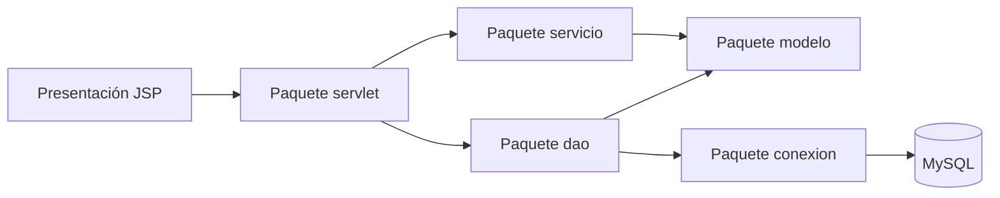
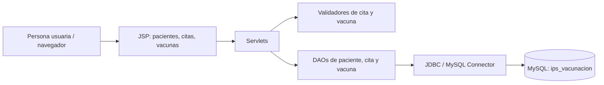
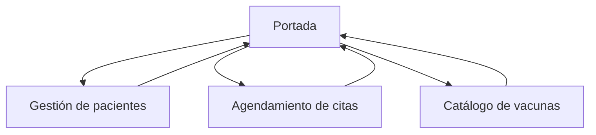

# Guía de la evidencia GA8-220501096-AA1-EV01

## 1. ¿Qué estamos construyendo?

El sistema ya tenía el módulo **Pacientes**, que registra y consulta a las personas atendidas por la IPS. Para demostrar la integración de componentes se añadieron dos módulos relacionados con ese proceso:

- **Citas:** agenda una atención de vacunación para un paciente y permite marcarla como programada, atendida o cancelada.
- **Vacunas:** registra el nombre, fabricante y cantidad disponible de cada vacuna.

La portada enlaza a los tres módulos. El módulo de citas usa el identificador interno del paciente para guardar la relación, pero la pantalla presenta el nombre y documento para que la persona usuaria pueda seleccionarlo sin conocer ese identificador.

## 2. Cómo viaja una solicitud por las capas

1. La persona usuaria abre una página JSP y llena un formulario (capa de presentación).
2. El formulario envía sus datos a una ruta, por ejemplo `/citas` (controlador Servlet).
3. El Servlet lee y valida datos básicos y llama al DAO correspondiente (capa de aplicación y acceso a datos).
4. El DAO utiliza JDBC y sentencias preparadas para consultar o guardar datos en MySQL (persistencia).
5. El Servlet devuelve la página con los datos o redirige al listado.

```text
Navegador → JSP → Servlet → DAO → JDBC → MySQL
                         ← datos ←
```

Los DAOs concentran el SQL; los Servlets coordinan la solicitud; los modelos (`Paciente`, `Cita`, `Vacuna`) representan los datos. Esta separación facilita mantener cada parte sin mezclar HTML y consultas SQL.

## 3. Componentes agregados

| Módulo | Entrada | Proceso | Salida |
|---|---|---|---|
| Citas | Paciente, vacuna, fecha y hora | Comprueba datos requeridos y que la fecha sea futura; guarda la cita | Listado de citas y estado |
| Estado de cita | Identificador y estado permitido | Actualiza el estado de la cita | Redirección al listado actualizado |
| Vacunas | Nombre, fabricante y dosis | Valida nombre y que las dosis no sean negativas; guarda o actualiza por nombre | Catálogo con inventario |

## 4. Historias de usuario

- Como auxiliar de la IPS, quiero seleccionar un paciente existente y agendar la vacuna y fecha para organizar su atención.
- Como auxiliar, quiero cambiar el estado de una cita para reflejar si fue atendida o cancelada.
- Como responsable del inventario, quiero registrar vacunas y sus dosis disponibles para consultar existencias.

## 5. Estructura de código

```text
src/main/java/co/edu/sena/ipsvacunacionweb/
  conexion/  → conexión JDBC existente
  modelo/    → Paciente, Cita y Vacuna
  dao/       → PacienteDAO, CitaDAO y VacunaDAO
  servlet/   → controladores web
src/main/webapp/
  index.jsp, pacientes.jsp, citas.jsp, vacunas.jsp
database/    → scripts SQL de los módulos nuevos
```

## 6. Preparar la base de datos

1. Inicia MySQL y confirma que ya existe la base `ips_vacunacion` y la tabla `paciente` usada por el sistema original.
2. Abre una herramienta SQL (por ejemplo MySQL Workbench) y ejecuta `database/modulo_citas.sql`.
3. Ejecuta `database/modulo_vacunas.sql`.
4. La tabla `cita` tiene una llave foránea hacia `paciente`: por eso se requiere registrar primero el paciente. También evita duplicar la misma fecha y hora para un paciente.

La conexión actual se encuentra en `conexion/ConexionBD.java`; apunta a `localhost:3306`, base `ips_vacunacion`, usuario `root` y contraseña vacía. Si la instalación local usa otras credenciales, hay que ajustarlas antes de iniciar el sistema. Para un despliegue real, las credenciales deben salir del código y guardarse en configuración protegida.

## 7. Ejecutar en ambiente local

Requisitos del proyecto: JDK 17, Maven, MySQL y Tomcat 10.1 (Jakarta Servlet 6). En una terminal abierta en la carpeta del proyecto:

```text
mvn clean package
```

El archivo WAR esperado se genera en `target/ips-vacunacion-web.war`. Cópialo a la carpeta `webapps` de Tomcat, inicia Tomcat y abre:

```text
http://localhost:8080/ips-vacunacion-web/
```

Desde la portada entra a **Pacientes**, **Citas** o **Vacunas**. Para agendar una cita, primero debe haber pacientes cargados y tablas creadas.

## 8. Pruebas manuales realizadas

Ambiente reportado durante la ejecución: Windows 11, Java 26.0.2.1, Maven 3.9.16, MySQL 8.0.30 y Apache Tomcat 10.1.60. Fecha de ejecución reportada: 10 de octubre de 2026. La aplicación se abrió localmente en `http://localhost:8080/ips-vacunacion-web/`.

| Prueba | Resultado esperado | Resultado observado | Estado |
|---|---|---|---|
| Abrir la página principal | Ver los enlaces a pacientes, citas y vacunas | La portada cargó en el navegador | Aprobada |
| Abrir el catálogo de vacunas | Consultar la tabla `vacuna` sin error | Se mostró el formulario y el listado | Aprobada |
| Registrar vacuna de prueba | Guardar y listar nombre, fabricante y dosis | Se registró “Vacuna de prueba”, fabricante “Prueba académica”, 5 dosis | Aprobada |
| Abrir gestión de pacientes | Consultar pacientes y mostrar formulario | La página cargó y mostró la lista vacía | Aprobada |
| Registrar paciente ficticio | Guardar paciente y mostrarlo en la lista | El usuario confirmó que se registró correctamente | Aprobada |
| Agendar cita futura | Asociar paciente, vacuna, fecha y estado inicial | La cita apareció con estado `Programada` | Aprobada |
| Cambiar estado de la cita | Guardar y mostrar el estado seleccionado | El usuario confirmó cambio a `Cancelada` | Aprobada |
| Reiniciar Tomcat | Volver a cargar los datos ya almacenados | El usuario confirmó que la vacuna y la cita continuaron en pantalla después del reinicio | Aprobada |
| Verificación tras reiniciar servicios | Abrir `/citas` y `/vacunas` y consultar sus registros | El usuario confirmó que ambas páginas cargaron sin errores y mostraron la información registrada | Aprobada |

Las capturas del navegador compartidas durante la sesión sirven como evidencia visual. La cita y el paciente son datos ficticios de prueba. La aplicación no tiene una función web para eliminar citas; si se desea limpiar los datos de prueba, hacerlo desde MySQL teniendo en cuenta primero borrar la cita para respetar la llave foránea.

## 9. Pruebas unitarias automatizadas

Se añadieron pruebas JUnit 5 para las reglas de negocio de `ValidadorCita` y `ValidadorVacuna`. Cubren citas futuras, rechazo de fechas pasadas, estados permitidos, nombres vacíos y dosis negativas. Estas pruebas se separan del acceso a MySQL, por lo que verifican las reglas sin modificar datos.

Las pruebas se deben ejecutar ahora en el computador de desarrollo con:

```text
mvn clean verify
```

Ejecución realizada el 10 de octubre de 2026: `Tests run: 6, Failures: 0, Errors: 0, Skipped: 0`; Maven finalizó con `BUILD SUCCESS` y generó `target/ips-vacunacion-web.war`.

## 10. Tecnologías y seguridad aplicada

Java 17, Maven, Jakarta Servlet/JSP, JDBC, MySQL y Tomcat 10.1. Los DAOs nuevos usan `PreparedStatement`, lo cual separa los valores del SQL. Las páginas usan `<c:out>` al mostrar los campos ingresados por usuarios. Los estados de cita se limitan a tres valores válidos y el inventario no acepta cantidades negativas.

La aplicación es una evidencia académica local. Antes de publicarla para uso real se requiere, entre otras cosas, autenticación y autorización, protección CSRF, configuración segura de secretos, manejo uniforme de errores y revisión de privacidad de los datos personales.

## 11. Requisitos y alcance implementado

### Requisitos funcionales cubiertos

| Código | Requisito | Módulo | Evidencia de cumplimiento |
|---|---|---|---|
| RF-01 | Registrar, consultar y editar pacientes | Pacientes | Formulario y listado conectado con MySQL |
| RF-02 | Registrar una vacuna con fabricante y dosis disponibles | Vacunas | Formulario y catálogo persistente |
| RF-03 | Agendar una cita futura para un paciente existente | Citas | Formulario, validación de fecha y listado |
| RF-04 | Consultar y cambiar el estado de una cita | Citas | Estados Programada, Atendida y Cancelada |
| RF-05 | Conservar los registros después de reiniciar el servidor | Citas y vacunas | Persistencia en MySQL comprobada manualmente por el usuario |

El alcance de esta versión se limita a pacientes, catálogo básico de vacunas y citas. Los diagramas previos describen un sistema más amplio. En particular, **Personal de Salud, Usuario y Registro de Vacunación no se implementaron en esta versión**. Tampoco se conectó la cita a una fila de la tabla `vacuna`: actualmente se almacena el nombre de la vacuna en la cita. Se documenta esta diferencia para que el estado real del software sea claro y verificable.

### Requisitos no funcionales considerados

- **RNF-01, organización:** separar presentación, control web, reglas de validación, acceso a datos y almacenamiento.
- **RNF-02, integridad:** usar llaves y restricciones en MySQL para las relaciones y datos del alcance implementado.
- **RNF-03, seguridad básica:** usar `PreparedStatement`, escapar contenido al mostrarlo y validar los valores de estado e inventario.
- **RNF-04, compatibilidad:** empaquetar como WAR para Tomcat 10.1 con Jakarta Servlet 6.
- **RNF-05, mantenibilidad:** mantener clases agrupadas por responsabilidad y nombres descriptivos.

La autenticación, autorización y despliegue público no hacen parte del alcance realizado.

## 12. Capas, librerías y frameworks

| Capa | Componentes del proyecto | Tecnología o librería | Función |
|---|---|---|---|
| Presentación | JSP: `index.jsp`, `pacientes.jsp`, `citas.jsp`, `vacunas.jsp`; `css/estilos.css` | JSP, Jakarta JSTL 3.0 y CSS | Mostrar formularios, listados y navegación con estilo compartido y adaptable |
| Control web | Servlets de pacientes, citas y vacunas | Jakarta Servlet API 6.0 | Recibir solicitudes, llamar servicios/DAO y elegir la respuesta |
| Reglas de aplicación | `ValidadorCita`, `ValidadorVacuna` | Java 17 | Validar fechas, estados, nombres y cantidades |
| Acceso a datos | `PacienteDAO`, `CitaDAO`, `VacunaDAO`, `ConexionBD` | JDBC y MySQL Connector/J 9.4 | Ejecutar consultas preparadas y administrar conexiones |
| Persistencia | Tablas `paciente`, `cita`, `vacuna` | MySQL 8 | Guardar la información de forma persistente |
| Pruebas | Pruebas de validadores | JUnit Jupiter 5.11 | Verificar reglas de negocio sin depender de MySQL |
| Construcción y servidor | `pom.xml`, paquete WAR | Maven 3.9 y Apache Tomcat 10.1 | Compilar, probar, empaquetar y ejecutar la aplicación |

La aplicación utiliza Servlet/JSP y JDBC; no se incorporó un framework MVC externo. JSTL es una librería de etiquetas para las páginas JSP.

## 13. Organización de paquetes y componentes

La estructura de paquetes del código es:

```text
co.edu.sena.ipsvacunacionweb
├── conexion       → conexión a MySQL
├── modelo         → Paciente, Cita y Vacuna
├── servicio       → validaciones reutilizables
├── dao            → consultas y persistencia
└── servlet        → controladores de solicitudes web
```

Diagrama de paquetes simplificado:



Diagrama de componentes de la versión implementada:



Los diagramas de clase y entidad-relación anteriores se conservan como referencia del diseño general. El software actual implementa una parte de ese diseño; no se modifican los diagramas anteriores para hacer parecer que las entidades pendientes ya funcionan.

Se aplica una separación tipo **Modelo-Vista-Controlador (MVC)**: las páginas JSP son las vistas, los Servlets coordinan las solicitudes y las clases del paquete `modelo` representan los datos. Para el acceso a persistencia se usa el patrón **DAO** (`PacienteDAO`, `CitaDAO`, `VacunaDAO`), que concentra las consultas SQL.

## 14. Metodología y navegación

Se trabajó de forma **incremental**: se partió del módulo de pacientes existente, se agregaron los módulos de vacunas y citas, y se verificó cada flujo desde el navegador. En cada incremento se revisaron la estructura de datos, las validaciones, la integración con MySQL y la navegación desde la portada. Las pruebas automatizadas cubren las reglas de validación; las pruebas manuales cubren los flujos completos con el servidor local.

Mapa de navegación:



La aplicación se desarrolló y ejecutó localmente con Visual Studio Code, Maven, MySQL de Laragon y Apache Tomcat 10.1. La edición del SQL se realizó con Visual Studio Code y la administración/consulta de la base de datos con la herramienta SQL disponible en el equipo.

## 15. Revisión de requisitos de la evidencia

| Elemento solicitado | Estado en esta entrega | Dónde se evidencia |
|---|---|---|
| Codificación e integración de módulos web | Cubierto para pacientes, citas y vacunas | Código fuente y pruebas manuales |
| Requerimientos e historias de usuario | Cubierto para el alcance implementado | Secciones 4 y 11 |
| Diagrama de clases | Referencia previa revisada; implementación parcial declarada | Documentos anteriores y sección 13 |
| Diagrama de paquetes y componentes | Documentado para el código actual | Sección 13 |
| Capas, librerías y frameworks | Documentado | Secciones 2 y 12 |
| Seguridad requerida | Medidas básicas descritas; autenticación no implementada | Sección 10 |
| Metodología de desarrollo | Documentada como proceso incremental realizado | Sección 14 |
| Mapa de navegación | Documentado | Sección 14 |
| Componentes reutilizables y buenas prácticas | Separación en servicios, DAO, modelos y Servlet | Secciones 2, 5 y 13 |
| Pruebas, construcción y despliegue local | Evidenciados con resultados registrados | Secciones 7 a 9 |
| Repositorio y paquete para entrega | Repositorio actualizado y paquete local preparado | Sección 16 |

## 16. Entrega de la evidencia

La entrega contiene el código fuente, scripts SQL, guía técnica, pruebas automatizadas y paquete WAR generado. El código fue guardado en el repositorio Git del proyecto. El ZIP preparado para compartir es `GA8-220501096-AA1-EV01-IPS-Vacunacion-Web.zip`. El despliegue realizado fue local; no hay URL pública de la aplicación en esta etapa. Antes de entregar, se recomienda adjuntar las capturas originales de la portada, registro de vacuna, paciente, cita y persistencia después del reinicio, si la plataforma de entrega permite anexos.
